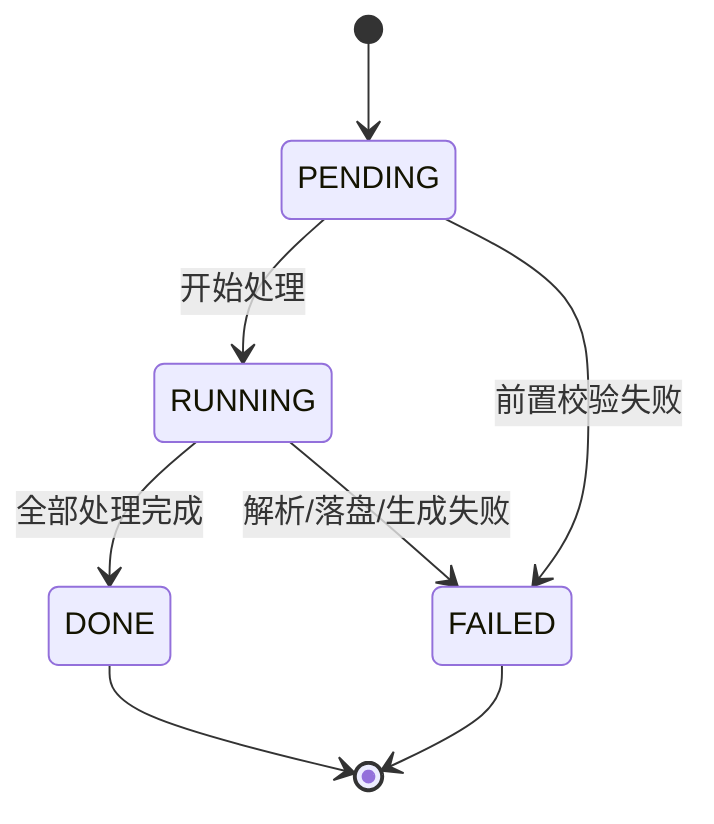
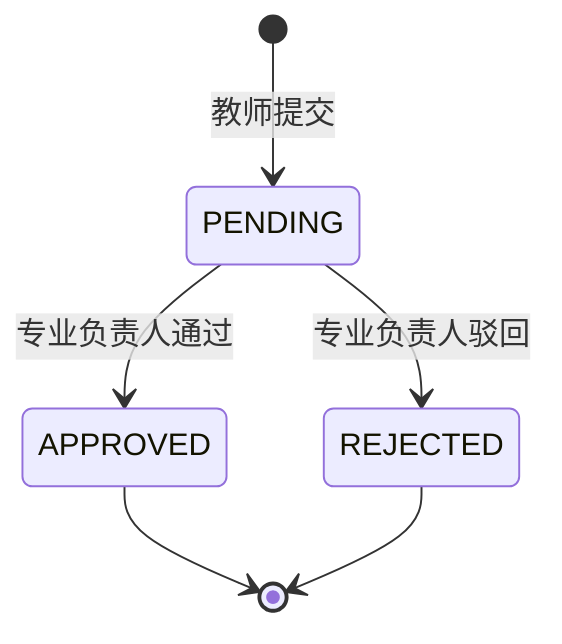
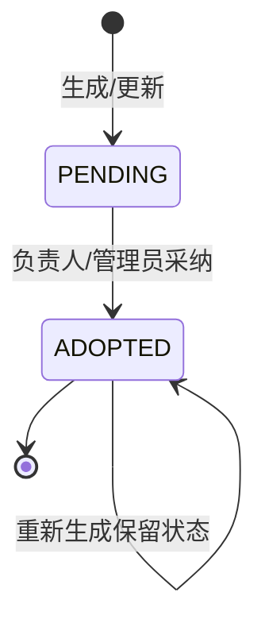

# 技术实施方案（plan.md）

> **版本：** v2.0（2026-11-24，按 plan-prompt v3.1 重构）
> **上游依据：** `spec.md`（v2，2026-11-23 评审生效；v1 归档于 `spec-v1.md`）
> **地位：** 本文把业务规格转化为可实现、可验收的技术方案；不替代 `spec.md`，不包含成品代码与完整 SQL。

## 0. 文档信息与使用边界

| 项目 | 内容 |
|---|---|
| 文档状态 | 草案（待评审）；spec v2 已评审生效，本文为技术方案重构稿 |
| 适用范围 | 全系统：网关、用户、数据、AI、课程资源与前端 |
| 目标读者 | 实现者、评审者、运维与后续接手的 AI Agent |
| 事实来源 | `spec.md`、`constitution.md`、`api-contracts.md`、`db-design.md`、既有代码与验证记录 |
| 强制规则 | 实现偏离本文必须先改本文并说明原因；本文偏离 spec 必须回到 spec 评审 |

## 1. 审查结论与架构决策

### 1.1 系统定位与目标路径

本系统是面向校内使用的产业数据与人才需求分析平台，采用“浏览器 SPA + 统一网关 + 五个后端服务 + 四个业务库”的微服务架构。目标路径不是重写，而是在既有棕地系统上持续演进：保留已验证的领域边界与服务拆分，用规格约束新增能力，避免为“架构先进性”引入不必要的中间件或抽象。

### 1.2 spec 审查结论

- **已确认信息：** 角色与权限边界、岗位样本唯一键与溯源要求、导入/抽取/预测/看板/课程资源/两类调整建议/报告/模型配置的完整业务链路、验收标准与失败路径。
- **信息缺口：**
  - 无明确的并发量、数据增长上限与 SLA 指标（spec NFR-11、TBD-06）。
  - 采集任务与报告导出的角色限制未定（C-02、TBD-02）。
  - 三员分立的强制边界未定（C-03、TBD-01）。
  - 委员会评审与教务备案是否纳入系统未定（C-04、TBD-03）。
- **关键假设：**
  - 校内单实例部署、有限并发可接受（ASM-02）。
  - 数据源已获授权（ASM-01）；大模型服务由采购方提供（ASM-03）。
  - 统计口径按自然季度/年度，时区 Asia/Shanghai（ASM-06）。
- **关键风险：**
  - 大模型限流/故障导致抽取质量波动（RISK-02/03）。
  - 缓存与检索索引和事实库不一致（RISK-04）。
  - 年度建议随数据变化漂移，影响评审连续性（RISK-05）。
  - 角色粒度过粗与审计覆盖不足（RISK-06/07）。
- **阻塞性缺口：** 无。上述缺口均已有显式降级或待确认登记，不阻塞方案落地。

### 1.3 宪法与治理对齐

| 宪法要求 | 本方案的落点 |
|---|---|
| 规格先行 | 所有新增能力先落 `spec.md` 场景/需求/AC，再进入本文与任务 |
| 极简与外科手术式修改 | 复用现有服务与表，不引入新中间件；新增能力优先“同库同服务”落地 |
| 显式失败、禁止静默兜底 | 数据依赖失败返回 502；业务冲突返回 409；权限不足返回 403 |
| 服务边界 | 跨服务只走 HTTP/消息，禁止跨库直连 |
| 可追溯 | 关键写操作写审计；建议与报告标注生成时间与数据版本 |

### 1.4 关键架构决策

| 编号 | 决策 | 理由 | 代价与边界 | 依据 |
|---|---|---|---|---|
| AD-01 | 保留“五服务 + 四库”拆分，不合并为单体 | 领域边界已稳定，合并会破坏既有部署与权限边界 | 运维复杂度高于单体；跨服务一致性依赖接口与补偿 | 现状、spec S-01~S-15 |
| AD-02 | 技术栈锁定 Java 8 + Spring Boot 2.7.18 + Spring Cloud 2021.0.8 | 与既有构建、镜像和依赖完全一致，避免全量回归 | 放弃 Java 17 语法与新版本特性；新代码必须兼容 Java 8 | 现状 pom、模板默认值降级 |
| AD-03 | MySQL 为事实源，Redis 仅缓存，Elasticsearch 仅检索，RocketMQ 仅异步解耦 | 保持“事实唯一”，避免 CQRS 过度设计 | 索引/缓存需可重建；一致性为最终一致 | spec INV-03 |
| AD-04 | 服务内分层：Controller → Service → Mapper → Entity；DTO 与实体分离 | 保持现有工程风格，降低维护成本 | 不引入 DDD 重型分层、不引入 CQRS 聚合 | 现状代码结构 |
| AD-05 | 前端单体 SPA（Vue 3 + TS + Element Plus），按页面拆分视图，不引入微前端 | 页面数量与团队规模不支撑微前端 | 打包体积随页面增长；需按路由懒加载 | 现状 frontend |
| AD-06 | 年度调整建议采用“请求时实时生成 + 幂等 upsert”，不新增调度器 | 保证数据最新，避免调度与幂等双复杂度 | 每次打开页面有生成开销；并发打开需依赖唯一键兜底 | plan v1 5.4、REQ-31~34 |
| AD-07 | 大模型接入采用“配置表 + 当前模型路由 + 规则回退” | 支持切换供应商，模型故障时保证基础抽取可用 | 回退结果质量低于模型；必须记录实际模型 | REQ-17~19、REQ-37~40 |

## 2. 领域建模与核心抽象

### 2.1 领域概念

| 概念 | 类型 | 职责 | 关键属性 |
|---|---|---|---|
| 岗位样本 JobSample | 实体（聚合根） | 承载一条可追溯的招聘信息 | 企业、岗位、区域、薪资、描述、来源、采集时间、质量状态 |
| 企业 Company | 实体 | 企业主数据 | 名称唯一、行业、规模 |
| 技能标签 SkillTag | 实体 | 归一化技能/工具/工程能力 | 名称唯一、类型 |
| 导入任务 ImportTask | 实体 | 一次文件导入的执行记录 | 任务号、状态、成功/失败数、失败明细 |
| 采集任务 CollectionTask | 聚合根 | 周期性数据获取配置 | 来源、周期、启停、最近执行结果 |
| 报告任务 ReportTask | 实体 | 报告异步生成记录 | 任务号、类型、年度、状态、产物 |
| 抽取结果 ExtractionResult | 实体 | 一条岗位的三类标签与模型 | 技能、工具、能力、模型名 |
| 需求预测 DemandForecast | 实体 | 区域/月份维度的预测值 | 区域、月份、需求值、模型 |
| 大模型配置 LlmModel | 聚合根 | 可调用模型与当前模型 | 名称、模型标识、BaseURL、Key、状态、是否当前 |
| 课程 Course | 聚合根 | 教学单元 | 编码唯一、名称、学分 |
| 知识技能点 KnowledgePoint | 实体 | 课程承载的知识/技能点 | 名称、类型 |
| 项目案例 ProjectCase | 实体 | 与课程关联的实践资源 | 名称、难度、资源地址 |
| 专业调整建议 Advice | 聚合根（审批流） | 单条提案与审批结论 | 标题、内容、状态、审批人/意见/时间 |
| 年度调整建议 AdjustmentPlanItem | 聚合根（年度建议） | 生成的分类建议与采纳状态 | 年度、编号、分类、优先级、依据、指标、状态 |
| 审计日志 AuditLog | 实体（只读） | 关键操作留痕 | 操作人、动作、对象、结果、IP、时间 |

### 2.2 聚合边界与不变量映射

| 聚合 | 包含 | 保护的不变量 | 一致性方式 |
|---|---|---|---|
| JobSample | 岗位样本、技能关联 | INV-01、INV-02 | 同库事务 + 唯一键；导入批量提交 |
| ImportTask | 导入任务、质量问题 | INV-02 | 任务状态与计数在同一次处理中更新 |
| Advice | 调整建议（审批） | INV-06 | 条件更新 `status=PENDING`，影响行数为 0 即 409 |
| AdjustmentPlanItem | 年度建议 | INV-07、INV-08、INV-13 | 唯一键 + upsert 保留已采纳；只读依赖失败即 502 |
| LlmModel | 模型配置 | INV-09 | 切换当前模型在事务内完成；当前模型删除/停用前置校验 |
| AuditLog | 审计记录 | INV-10、INV-12 | 只插入，不提供修改/删除入口 |
| Course | 课程、技能点绑定、案例 | 课程编码唯一 | 唯一键 + 服务内校验 |

### 2.3 核心状态机

**导入任务 / 报告任务：**



**专业调整建议（审批工作流）：**



**年度调整建议（采纳）：**



状态机的所有非法迁移必须返回明确错误（403/409/422），不得静默忽略或改写为合法状态。

### 2.4 模块与目录结构

**后端（每服务同构）：**

```text
<service>/src/main/java/edu/niit/rcyc/<service>/
├── controller/        # HTTP 入口，只做参数校验、身份提取、权限守卫
├── service/           # 业务编排、事务边界、状态机
├── mapper/            # MyBatis-Plus 数据访问
├── entity/            # 持久化实体
├── dto/               # 请求/响应模型
├── client/            # 跨服务 Feign 客户端
├── config/            # 初始化、Feign、序列化、线程池
└── common/            # ApiResponse、BizException、RoleGuard、RequestIdentity
```

**前端：**

```text
frontend/src/
├── api/               # 按领域拆分的请求函数
├── views/             # 页面级视图
├── layouts/           # 应用外壳与导航
├── components/        # 可复用展示组件
├── stores/            # 认证等全局状态
├── router/            # 路由与守卫
├── types/             # 领域类型
└── utils/             # 常量、格式化
```

### 2.5 关键抽象与复用点

| 抽象 | 职责 | 复用约束 |
|---|---|---|
| `ApiResponse<T>` | 统一 `{code,message,data}` 响应 | 所有 Controller 必须使用 |
| `BizException` | 业务异常与 HTTP 语义映射 | 业务失败必须抛出，不得返回 null 代替 |
| `RoleGuard` + `RequestIdentity` | 服务端角色校验与身份提取 | 不得信任前端传入的角色 |
| `AuditService` | 统一写审计 | 关键写操作必须调用 |
| `DataServiceClient` | 课程服务读取数据服务统计 | 失败必须显式转为 502 |
| `LlmModelRouter` | 选择当前模型并记录调用 | 无可用模型时回退规则引擎 |
| 初始化器（ApplicationRunner） | 启动时幂等建表/播种 | 只做 DDL 与种子，不承载业务逻辑 |

## 3. 前后端边界与 API 契约

### 3.1 页面与状态职责

| 页面/路由 | 主要职责 | 状态来源 | 加载/失败表现 |
|---|---|---|---|
| `/login` | 登录 | 认证接口 | 失败提示，不泄露账号是否存在 |
| `/dashboard` | KPI 与图表 | 统计接口 | 骨架屏；空数据展示空态 |
| `/jobs` | 岗位检索、详情、语义检索、相似岗位 | 岗位接口 | 分页空态；检索失败可重试 |
| `/import` | 导入、任务历史、质量报告、采集任务 | 数据服务 | 轮询任务进度；失败展示原因 |
| `/ai` | 单条抽取、批量进度、预测 | AI 服务 | 模型不可用提示回退/失败 |
| `/curriculum` | 课程、技能点、案例、建议审批 | 课程服务 | 页签内独立加载 |
| `/adjustments` | 年度建议、筛选、详情、采纳、进度 | 课程服务 | 无权限只读；数据服务失败显示重试 |
| `/system` | 用户、角色、审计、模型配置 | 用户/AI 服务 | 按角色隐藏页签 |

前端只负责展示与交互，不以隐藏按钮作为权限控制；所有状态变更以服务端返回为准。

### 3.2 API 契约骨架

> 统一前缀 `/api/v1`；除登录与内部接口外均需 `Authorization: Bearer <JWT>`；响应为 `{code,message,data}`。

| 方法 | 路径 | 职责 | 主要入参 | 主要出参 | 主要错误 |
|---|---|---|---|---|---|
| POST | `/auth/login` | 登录 | username, password | token, user(roles) | 401 |
| GET | `/auth/me` | 当前身份 | — | user(roles) | 401 |
| GET | `/users` | 用户分页 | page,size,keyword | 分页用户 | 403 |
| POST | `/users` | 创建用户 | username,password,realName,roles | 用户 | 400/403/409 |
| PUT | `/users/{id}/status` | 启停账号 | status | 用户 | 403/404 |
| PUT | `/users/{id}/roles` | 分配角色 | roles | 用户 | 400/403 |
| GET | `/audit/logs` | 审计分页 | page,size,operator,timeRange | 分页日志 | 403 |
| POST | `/data/import/jobs` | 上传导入 | multipart file | taskId | 400/422 |
| GET | `/data/import/tasks/{taskId}` | 导入进度 | — | 状态/计数/失败明细 | 404 |
| GET | `/data/import/tasks` | 导入历史 | page,size | 分页任务 | — |
| GET | `/data/quality/report` | 质量报告 | — | 汇总指标 | — |
| GET | `/data/quality/issues` | 质量问题 | page,size | 问题列表 | — |
| GET | `/data/jobs/search` | 岗位检索 | 关键字/区域/技能/分页 | 分页岗位 | 400 |
| GET | `/data/jobs/{id}` | 岗位详情 | — | 岗位详情 | 404 |
| GET | `/data/jobs/{id}/trace` | 数据溯源 | — | 来源信息 | 404 |
| POST | `/data/jobs/semantic-search` | 语义检索 | query,region,size | total,list | 400/503 |
| GET | `/data/jobs/{id}/similar` | 相似岗位 | size | 列表 | 404 |
| GET | `/data/jobs/stats` | 看板统计 | region,skill,timeRange | KPI/趋势/分布/排行 | 400 |
| GET | `/data/jobs/skills/heat` | 技能热度 | limit | name,value 列表 | — |
| GET | `/data/jobs/extraction-progress` | 抽取进度 | — | total/done/pending/percent | — |
| POST | `/data/jobs/reindex` | 重建索引 | — | indexed | 503 |
| GET | `/data/collection-tasks` | 采集任务分页 | page,size | 分页任务 | — |
| POST | `/data/collection-tasks` | 创建采集任务 | taskName,sourceType,sourceUrl,cronExpr,status | 任务 | 422 |
| PUT | `/data/collection-tasks/{id}` | 更新采集任务 | 同上 | 任务 | 404/422 |
| POST | `/data/collection-tasks/{id}/run` | 立即执行 | — | 最近执行结果 | 404/502 |
| DELETE | `/data/collection-tasks/{id}` | 删除采集任务 | — | 成功 | 404 |
| GET | `/data/reports/annual` | 同步报告 | format,year | 文件流 | 400 |
| GET | `/data/reports/annual/excel` | 同步 Excel | year | 文件流 | 400 |
| POST | `/data/reports/async` | 创建报告任务 | format,year | taskId,status | 400 |
| GET | `/data/reports/async/{taskId}` | 报告进度 | — | 状态/消息 | 404 |
| GET | `/data/reports/async/{taskId}/download` | 下载报告 | — | 文件流 | 404/409 |
| POST | `/ai/extract` | 单条抽取 | jobDescription | skills/tools/abilities | 422/502 |
| GET | `/ai/extractions` | 抽取结果分页 | page,size | 分页结果 | — |
| GET | `/ai/extractions/{jobId}` | 单岗位抽取结果 | — | 结果 | 404 |
| GET | `/ai/forecast` | 需求预测 | region,months | region,model,points | 400/422 |
| GET | `/ai/forecast/history` | 预测历史 | region | 历史点 | — |
| GET | `/ai/forecast/regions` | 可选区域 | — | 区域列表 | — |
| GET | `/ai/llm/models` | 模型列表与用量 | — | 模型列表（Key 脱敏） | 403 |
| POST | `/ai/llm/models` | 新增模型 | 名称/标识/服务商/BaseURL/Key | 模型 | 400/403/409 |
| PUT | `/ai/llm/models/{id}` | 编辑模型 | 同上（Key 可空） | 模型 | 400/403/404 |
| DELETE | `/ai/llm/models/{id}` | 删除模型 | — | 成功 | 403/404/409 |
| POST | `/ai/llm/models/{id}/activate` | 设为当前 | — | 模型 | 403/404/409 |
| GET | `/curriculum/courses` | 课程分页 | page,size,keyword | 分页课程 | — |
| GET | `/curriculum/courses/all` | 课程下拉 | — | 课程列表 | — |
| GET | `/curriculum/courses/{id}` | 课程详情 | — | 课程/技能点/案例 | 404 |
| POST | `/curriculum/courses` | 新增课程 | code,name,credit,description | 课程 | 403/409 |
| PUT | `/curriculum/courses/{id}` | 编辑课程 | 同上 | 课程 | 403/404 |
| DELETE | `/curriculum/courses/{id}` | 删除课程 | — | 成功 | 403/404 |
| POST | `/curriculum/courses/{id}/points` | 绑定技能点 | pointIds | 成功 | 400/404 |
| GET | `/curriculum/courses/{id}/points` | 课程技能点 | — | 技能点列表 | 404 |
| GET | `/curriculum/knowledge-points` | 技能点分页 | page,size | 分页技能点 | — |
| POST | `/curriculum/knowledge-points` | 新增技能点 | name,type,description | 技能点 | 403 |
| PUT | `/curriculum/knowledge-points/{id}` | 编辑技能点 | 同上 | 技能点 | 403/404 |
| DELETE | `/curriculum/knowledge-points/{id}` | 删除技能点 | — | 成功 | 403/404 |
| GET | `/curriculum/project-cases` | 案例分页 | page,size | 分页案例 | — |
| POST | `/curriculum/project-cases` | 新增案例 | name,courseId,difficulty,url | 案例 | 403 |
| PUT | `/curriculum/project-cases/{id}` | 编辑案例 | 同上 | 案例 | 403/404 |
| DELETE | `/curriculum/project-cases/{id}` | 删除案例 | — | 成功 | 403/404 |
| GET | `/curriculum/stats` | 课程资源统计 | — | 课程/技能点/建议数 | — |
| GET | `/curriculum/advice` | 建议分页 | page,size,status | 分页建议 | — |
| POST | `/curriculum/advice` | 提交建议 | title,content | 建议 | 400/403 |
| GET | `/curriculum/advice/{id}` | 建议详情 | — | 建议 | 404 |
| POST | `/curriculum/advice/{id}/approve` | 审批建议 | decision,comment | 建议 | 403/404/409 |
| GET | `/curriculum/advice/export` | 导出建议 | format,status | 文件流 | 400 |
| GET | `/curriculum/adjustments/plan` | 年度建议计划 | — | 周期/KPI/清单/进度 | 502 |
| GET | `/curriculum/adjustments/{id}` | 年度建议详情 | — | 建议 | 404 |
| POST | `/curriculum/adjustments/{id}/adopt` | 采纳建议 | — | 建议 | 403/404/409 |
| POST | `/internal/audit` | 服务间写审计 | 审计请求 + 内部令牌 | 成功 | 401 |

### 3.3 统一响应与错误语义

| HTTP | code | 使用场景 | 前端处理 |
|---|---|---|---|
| 200 | 200 | 成功 | 正常渲染 |
| 400 | 400 | 参数格式/枚举非法 | 表单定位提示 |
| 401 | 401 | 未登录/令牌失效 | 跳转登录 |
| 403 | 403 | 角色不足 | 提示无权限，不重试 |
| 404 | 404 | 资源不存在 | 空态/返回列表 |
| 409 | 409 | 状态冲突（重复审批/采纳/编码重复） | 提示刷新后重试 |
| 422 | 422 | 业务校验失败（Cron/文件类型） | 就地提示 |
| 502 | 502 | 外部依赖不可用（数据服务/模型） | 可重试，展示原因 |
| 500 | 500 | 未预期异常 | 通用错误，记录日志 |

### 3.4 前后端协作约束

| 约束 | 内容 |
|---|---|
| Base URL | 前端统一走同源 `/api/v1`，由 Nginx 转发网关 |
| 类型契约 | 前端 `types` 与后端 DTO 字段一一对应；新增字段必须同步 |
| 错误处理 | 拦截器统一解析 `code/message`；401 清理会话；403 跳转无权限 |
| 权限 | 前端隐藏入口仅改善体验，服务端必须再次校验 |
| 文件 | 上传使用 multipart；下载使用二进制流并处理文件名编码 |
| 时间 | 统一 `yyyy-MM-dd HH:mm:ss`，时区 Asia/Shanghai |
| 长任务 | 导入/报告/抽取使用任务号 + 轮询，禁止前端阻塞等待 |

### 3.5 模型映射

- Entity 只用于持久化，不直接作为 Controller 出参（历史简单查询除外，需评审）。
- 写请求使用独立 DTO 并做 Bean Validation；响应视图可裁剪敏感字段（如 API Key）。
- 枚举在 DTO 中使用字符串，避免前端依赖数字码；非法值在服务端拒绝。

## 4. 非功能性与运行设计

### 4.1 显式失败与降级边界

| 场景 | 策略 | 不得出现的行为 |
|---|---|---|
| 数据库异常 | 回滚事务，返回 500 | 返回空列表冒充成功 |
| 数据服务不可用（年度建议） | 返回 502 | 生成占位或历史缓存建议 |
| 大模型不可用（抽取） | 回退规则词典；仍失败则 502 | 返回空数组冒充抽取成功 |
| 权限不足 | 403 | 前端隐藏代替服务端校验 |
| 状态冲突 | 409 | 覆盖式更新终态 |
| 非法周期/格式 | 422 | 静默保存或停用 |

### 4.2 配置与启动校验

- 配置外置：数据库、Nacos、Redis、ES、MQ、模型 Key、内部令牌均通过环境变量或配置文件注入。
- 启动时仅做幂等初始化：建表、种子数据；失败必须阻止启动（fail-fast）。
- **安全整改项：** 模型 Key 不得硬编码在仓库配置中；当前存在历史明文配置，应迁移到环境变量/密钥管理（RISK-02，待处理）。
- Nacos 服务发现开启；跨服务调用使用服务名，不使用固定 IP。

### 4.3 可观测性

- 健康检查：各服务暴露 `health`；网关与前端提供可用性探测。
- 日志：统一 INFO 级别记录关键业务动作与外部调用结果；异常记录堆栈与上下文。
- 审计：关键写操作写入 `sys_audit_log`；AI 调用写入 `llm_call_log`。
- 当前未引入链路追踪（待确认）；跨服务排障依赖请求参数与日志关联。

### 4.4 安全边界

- JWT 在网关校验，身份与角色通过请求头传递到下游；下游必须再次做角色守卫。
- 内部接口使用内部令牌，不对外暴露。
- 文件上传限制类型与大小；报告下载校验任务归属与状态。
- 敏感字段（API Key）只写不读；接口仅返回“已配置”状态。

## 5. 测试驱动与验收契约

### 5.1 测试分层

| 层级 | 目标 | 工具与方式 | 覆盖重点 |
|---|---|---|---|
| 单元测试 | 规则与状态机 | JUnit 5（Java 8 兼容）+ Mockito | 优先级阈值、状态迁移、去重规则 |
| 服务测试 | 事务与接口契约 | `@SpringBootTest` + MockMvc / 事务回滚 | 审批/采纳并发、导入幂等 |
| 集成测试 | 跨服务链路 | 启动依赖容器 + 测试库 | 建议生成、报告任务、模型切换 |
| 前端测试 | 页面行为 | 构建校验 + 浏览器验证 | 路由、权限、筛选、错误态 |
| 验收测试 | AC 对照 | 手工脚本 + 接口证据 | 每条 AC 至少一条可复核证据 |

前端当前以 `npm run build` 与浏览器实测为主要验证手段；组件测试框架【待确认】。

### 5.2 表驱动测试设计示例

**对象：** 年度建议优先级与生成规则（AC-ADJ-01、AC-CUR-02）。

| 用例 | 样本总量 | 条目样本数 | 预期占比 | 预期优先级 | 预期分类/编号 |
|---|---:|---:|---:|---|---|
| T1 | 1000 | 250 | 25.0% | HIGH | DIRECTION / ADJ-2027-D01 |
| T2 | 1000 | 100 | 10.0% | MEDIUM | DIRECTION / ADJ-2027-D02 |
| T3 | 1000 | 99 | 9.9% | LOW | COURSE / ADJ-2027-C01 |
| T4 | 0 | 0 | 0% | LOW（不除零） | 不生成条目 |
| T5 | 1000 | 200 | 20.0% | HIGH（边界含等号） | SKILL / ADJ-2027-S01 |

**对象：** 建议审批状态机（AC-CUR-03/04）。

| 当前状态 | 操作者角色 | 决策 | 预期结果 | 预期错误 |
|---|---|---|---|---|
| PENDING | MAJOR_LEADER | APPROVED | APPROVED | — |
| PENDING | MAJOR_LEADER | REJECTED | REJECTED | — |
| PENDING | TEACHER | APPROVED | 不变 | 403 |
| APPROVED | MAJOR_LEADER | APPROVED | 不变 | 409 |
| REJECTED | MAJOR_LEADER | REJECTED | 不变 | 409 |

**对象：** 导入去重（AC-DATA-03）。

| 已有记录 | 新导入 | 预期岗位数 | 预期结果 |
|---|---|---:|---|
| 唯一键 A | 唯一键 A（内容更新） | 1 | 覆盖更新 |
| 唯一键 A | 唯一键 B | 2 | 新增 |
| 唯一键 A | 缺企业名称 | 1 | 失败计数 +1，给出原因 |

### 5.3 AC → 测试策略映射

| AC | 测试层级 | 关键断言 |
|---|---|---|
| AC-AUTH-01 | 服务 + 浏览器 | 登录返回 token/roles；可进入角色页面 |
| AC-AUTH-02 | 服务 | 401/403；无数据变更 |
| AC-BIZ-02 | 服务 | 四类角色越权矩阵全部拒绝 |
| AC-DATA-01 | 集成 | 5000 行 ≤10s；成功+失败=总数 |
| AC-DATA-02 | 服务 | 溯源字段与导入记录一致 |
| AC-DATA-03 | 服务 | 重复导入不增行；非法行计入失败 |
| AC-DATA-04 | 服务 | 到期/手动执行；非法 Cron 422 |
| AC-DATA-05 | 集成 | 质量报告与抽取进度口径一致 |
| AC-AI-01 | 集成 + 人工抽检 | 三类标签齐全；抽检 ≥85% |
| AC-AI-02 | 服务 | 3 个月点；无数据明确失败 |
| AC-AI-03 | 集成 | 排序与区域筛选生效 |
| AC-AI-04 | 服务 | 结果不含自身 |
| AC-AI-05 | 集成 | 模型故障回退；回退失败 502 |
| AC-BIZ-01 | 浏览器 | 六类图表有数据且与接口一致 |
| AC-BIZ-03 | 服务 | 三种格式可下载且内容一致 |
| AC-BIZ-04 | 服务 | 未完成任务下载 409 |
| AC-CUR-01 | 服务 + 浏览器 | 课程详情含技能点/案例；编码唯一 |
| AC-CUR-02 | 集成 | 三类齐全；总数 ≥4 |
| AC-CUR-03 | 服务 | 合法迁移成功；终态再审批 409 |
| AC-CUR-04 | 服务 | 教师审批 403 |
| AC-CUR-05 | 服务 | Word/PDF 内容与记录一致 |
| AC-ADJ-01 | 集成 | 2/4/3 分类与真实指标；编号唯一 |
| AC-ADJ-02 | 集成 | 重新生成保留 ADOPTED 与采纳人/时间 |
| AC-ADJ-03 | 服务 | 采纳成功；越权 403；重复 409 |
| AC-ADJ-04 | 浏览器 + 服务 | 四阶段状态与采纳数真实 |
| AC-ADJ-05 | 服务 | 数据服务故障返回 502 且不落库 |
| AC-LLM-01 | 服务 | 列表无明文 Key |
| AC-LLM-02 | 服务 | 当前模型唯一；删除/停用当前 409 |
| AC-LLM-03 | 集成 | 调用当前模型并记录模型名 |
| AC-SYS-01 | 服务 | 用户/角色变更成功并写审计；非管理员 403 |
| AC-SYS-02 | 服务 | 审计查询角色矩阵 |
| AC-SYS-03 | 集成 | 关键动作均有审计记录 |
| AC-UI-01 | 浏览器 | 导航按角色渲染；越权地址跳 403 |

### 5.4 追踪链

`SCN → REQ → AC → 测试用例/类 → 接口路径 → 实现类`。

要求：新增或修改需求时，同步更新测试用例名称（直接引用 AC 编号），并在 PR/变更说明中给出 AC 与测试证据的对应关系。

## 6. 实施路径与风险控制

### 6.1 里程碑与端到端闭环

| 里程碑 | 交付内容 | 验证方式 |
|---|---|---|
| M0 基线可用 | 五服务 + 网关 + 前端可启动；登录可用 | 健康检查、登录冒烟 |
| M1 数据链路 | 导入、去重、质量、溯源、采集任务 | AC-DATA-01~05 |
| M2 分析与 AI | 检索、看板、抽取、预测、模型配置 | AC-AI-01~05、AC-BIZ-01、AC-LLM-01~03 |
| M3 课程资源 | 课程、技能点、案例、建议审批 | AC-CUR-01~05 |
| M4 年度建议 | 生成、采纳、评审进度 | AC-ADJ-01~05 |
| M5 治理 | 用户/角色、审计、导出、权限矩阵 | AC-SYS-01~03、AC-BIZ-02~04、AC-AUTH-01~02、AC-UI-01 |

每个里程碑必须包含：实现 → 自动/接口验证 → 浏览器验证（涉及前端）→ 文档同步 → 风险说明。

### 6.2 技术限制与明确不采用

| 项 | 决策 | 原因 |
|---|---|---|
| Java 17 / Spring Boot 3 | 不采用 | 与既有 Java 8 构建、依赖、镜像不一致，升级成本高且非业务价值 |
| 微前端 / 独立前端服务 | 不采用 | 页面规模不支撑，增加部署与联调成本 |
| 全量事件驱动 / CQRS | 不采用 | 当前一致性要求可用事务+任务满足，事件溯源会显著增加复杂度 |
| 分布式事务 | 不采用 | 跨服务写少；采用幂等、补偿与状态查询 |
| 多租户 | 不采用 | 单校部署，无租户隔离需求 |
| 自动机器学习平台 | 不采用 | 超出业务范围（spec O-06） |
| 模型 Key 明文入库 | 现状（待整改） | 安全风险，已登记 RISK-02，后续迁移密钥管理 |

## 附录 A：现有实现事实（用于落地对齐）

| 项 | 事实 |
|---|---|
| 后端 | Java 8、Spring Boot 2.7.18、Spring Cloud 2021.0.8、Spring Cloud Alibaba 2021.0.5.0 |
| 持久化 | MyBatis-Plus 3.5.5；MySQL 8.0，四库：user_db、data_db、ai_db、curriculum_db |
| 中间件 | Nacos 注册发现；Redis 缓存；Elasticsearch 检索；RocketMQ 异步消息 |
| 服务 | gateway(8080)、user(8081)、data(8082)、ai(8083)、curriculum(8084)；前端 Nginx(80) |
| 前端 | Vue 3 + TypeScript + Vite + Element Plus + Pinia |
| 鉴权 | JWT + 服务端角色守卫；内部接口使用内部令牌 |
| 异步 | 导入/报告任务落库 + 轮询；抽取通过消息触发并回写状态 |

## 附录 B：关键业务实现约束（沿用 v1 已验证结论）

- **端口与自适应**：本地配置使用 3307/18848/19876 等映射端口；容器内使用服务名与内网端口，配置必须外置。
- **报告导出**：同步导出保留；异步任务状态 `PENDING/RUNNING/DONE/FAILED`，未完成下载返回 409，文件目录可配置。
- **采集任务**：Cron 为 6 段；非法表达式返回 422；执行复用导入链路。
- **课程页深链**：`/curriculum?tab=advice` 保留；侧边栏“专业调整建议”指向 `/adjustments`。
- **年度建议**：计划年度 = 当前年 + 1；周期为前一年 10-01 至 12-15；数据版本为当前季度；编号 `ADJ-{year}-D/C/Sxx`；数据服务故障返回 502。
- **评审进度**：四阶段固定；仅生成与负责人复核反映真实状态，后两阶段为未发起。
